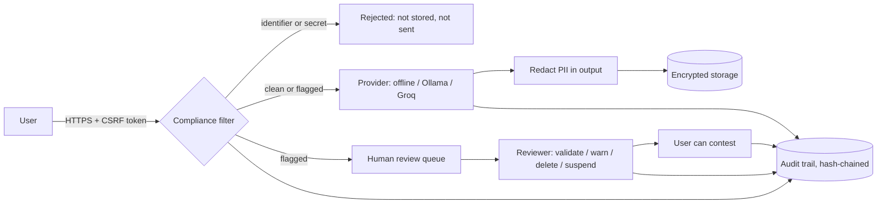

# Lumen AI

**A privacy-first, accountable AI assistant for organizations.** Built with Flask and SQLite, it shows users exactly where their data goes, keeps a human in charge of every decision, and ships with the compliance paperwork (risk register, DPIA, governance, transfer assessment) a real deployment needs.

> Lumen is a reference implementation of *responsible AI by design*. It is not legal advice: the documents in `docs/fr/` must be adapted and validated by your organization before production use.

## Why Lumen

Most chatbot demos ignore the questions an organization must answer before deploying AI: *where does the data go, who can read it, who decides when something goes wrong, and can people contest it?* Lumen answers each one in code, in the interface, and in documentation.

| Principle | How it is implemented |
|---|---|
| **Transparency** | The *Ask* page shows the path of your message (scan, provider, storage, review). Every answer is labelled AI-generated. Public pages explain limits and risks. |
| **Data minimisation** | Pseudonymous accounts (no name, no e-mail). A filter rejects identifiers and secrets *before* storage or any provider call. |
| **Privacy by default** | Default provider is **offline**: nothing leaves the server. External processing is opt-in, disclosed, traced per request, and users can object. |
| **Security** | Encryption at rest, scrypt hashes, CSRF tokens, strict CSP, login throttling, session hardening. |
| **Human oversight** | Flagged content goes to a reviewer. Only humans warn, delete or suspend, with a written reason. |
| **Contestability** | Any answer or decision can be contested; suspended users keep access to contest, export and erase. |
| **Accountability** | Tamper-evident audit trail (hash chain) and automatic retention purge. |

## Quick start

```bash
git clone <your-repo-url> lumen-ai && cd lumen-ai
python -m venv .venv && source .venv/bin/activate      # Windows: .venv\Scripts\Activate.ps1
pip install -r requirements.txt
cp .env.example .env                                   # Windows: copy .env.example .env
flask --app lumen create-admin yourname                # prompts for a password
python run.py                                          # http://127.0.0.1:5000
```

There is **no default account**. Create the first administrator with the command above, then other users register at `/register` (set `REGISTRATION_CODE` to restrict this).

## AI providers

Set `LLM_PROVIDER` in `.env`:

| Provider | Value | Data leaves your infrastructure? |
|---|---|---|
| Built-in rules (default) | `offline` | No. Answers questions about Lumen itself only. |
| Local open-weights model | `ollama` | No. Run [Ollama](https://ollama.com) and pull a model (`ollama pull llama3.1:8b`). |
| Groq-hosted Llama | `groq` + `GROQ_API_KEY` | **Yes, to the United States.** Read `docs/fr/transferts-groq.md` first. |

Each stored request records its provider and whether it was an external transfer, and users can opt out of external processing in *Settings*.

## Configuration

All settings are environment variables; see [`.env.example`](.env.example). Key ones: `LUMEN_ENV`, `SECRET_KEY`, `DATA_ENCRYPTION_KEY`, `ORG_NAME`, `DPO_CONTACT`, `REGISTRATION_CODE`, `LLM_PROVIDER`, `REQUEST_RETENTION_DAYS`. To give the assistant organization knowledge, copy `config/knowledge_base.example.md` to `config/knowledge_base.md`.

## Commands

```bash
flask --app lumen create-admin <username>   # first administrator
flask --app lumen reset-password <username> # lost password (no e-mail is collected)
flask --app lumen purge                     # delete expired data now (also automatic, every 24h)
flask --app lumen verify-audit              # check the audit hash chain
pytest -q                                   # run the test suite
```

## How a request flows



More detail in [`docs/architecture.md`](docs/architecture.md).

## Project layout

```
lumen/            application package (factory in __init__.py)
  auth.py chat.py privacy.py admin.py pages.py     routes
  compliance.py ai_service.py crypto.py audit.py   core services
  security.py retention.py db.py schema.sql        infrastructure
  templates/ static/                               UI (no inline scripts, no third-party assets)
tests/            62 tests: compliance rules, security, rights, oversight, audit, retention
docs/fr/          compliance documentation (French)
docs/architecture.md
```

## Compliance documentation (French)

| Document | Content |
|---|---|
| [`docs/fr/definition-of-compliance.md`](docs/fr/definition-of-compliance.md) | Compliance criteria mapped to code, tests and status |
| [`docs/fr/analyse-juridique.md`](docs/fr/analyse-juridique.md) | GDPR, Moroccan Law 09-08, AI Act, cybersecurity framework |
| [`docs/fr/methodologie-risques.md`](docs/fr/methodologie-risques.md) | Referenced 5-level scales (ISO 31000, ISO/IEC 23894, NIST AI RMF, CNIL) |
| [`docs/fr/cartographie-des-risques.md`](docs/fr/cartographie-des-risques.md) | 18 risks, heat maps, treatment plan (generated from `docs/risk_register.json`) |
| [`docs/fr/aipd-dpia.md`](docs/fr/aipd-dpia.md) | Data protection impact assessment and record of processing |
| [`docs/fr/gouvernance-ia.md`](docs/fr/gouvernance-ia.md) | Roles, oversight, contestation, incidents |
| [`docs/fr/transferts-groq.md`](docs/fr/transferts-groq.md) | Assessment of the external transfer to Groq |
| [`docs/fr/politique-utilisation.md`](docs/fr/politique-utilisation.md) | Acceptable use policy |

## Limitations and roadmap

Honest list of what Lumen does **not** do yet:

- The personal-data filter is pattern-based: it cannot detect free-text names or obfuscated data (planned: NER-based detection).
- No multi-factor authentication and no e-mail password reset (by design, no e-mail is collected; an administrator resets passwords via CLI).
- No conversation memory: each request is independent.
- Bias is a property of the underlying model; Lumen discloses and monitors it but cannot remove it.
- Organizational steps (regulator declarations, processor agreements, DPO opinion) cannot be automated; they are listed in the compliance documents.

## License

MIT, see [LICENSE](LICENSE). Contributions welcome: see [CONTRIBUTING.md](CONTRIBUTING.md). Security reports: [SECURITY.md](SECURITY.md).
